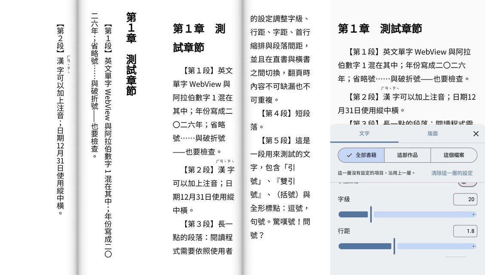

<div align="center">


# Bookmania

An ebook reader for Android, made for Chinese text in vertical and horizontal writing.

[正體中文](./README.md) ・ [Download](https://github.com/N09527/bookmania/releases) ・ [Changelog (Chinese)](./CHANGELOG.md) ・ [Issues](https://github.com/N09527/bookmania/issues)

[](./LICENSE)
[](#download)



</div>

## Features

### Text reader

- EPUB (2 and 3), MOBI and AZW3 (KF8). Put books in the local source folder, open them from Browse > Local source and add them to the library.
- Vertical and horizontal writing; page direction from the book, or always right-to-left or left-to-right.
- One or two columns, or two columns in landscape only. With two columns, a shadow can be drawn in the fold between them.
- Typesetting: font (TTF/OTF fonts can be imported), font size, line height, letter spacing, first-line indent, paragraph spacing, top/bottom/left/right margins, and bold text. Each value can be set with its slider or typed in.
- Settings at three levels: all books, this work, this file.
- Ruby (furigana, zhuyin) shown as marked up in the book.
- Page turn animation: curl, slide, or none.
- Table of contents, a progress slider for the whole book, a chapter panel for the other files of the work; tap zones and volume keys turn pages.
- The reading position of each book is kept and updates the progress, read state and history in the library. Backups include reading positions.

### WebDAV sync

- Through your own WebDAV server (HTTPS only), the library, reading progress, settings and book files are kept in sync between Android and iPhone/iPad.
- A book takes the newest progress when it opens and sends its progress when it is left.
- Data goes only to the server you set. See the [guide](./docs/extensions-and-sync/sync-guide.md) (Chinese).

### Security and privacy

- Only books without DRM can be read. A book protected by DRM shows an explanation; Bookmania does not try to decrypt it, and it does not and will not offer any way to remove DRM.
- Book content is untrusted: scripts in a book do not run, a book cannot reach the network, and it cannot read the App's other files.
- No crash reports and no usage analytics are sent.

### Features from Yōkai

The library and categories, the local source, the comic (image) reader, backup and restore, and more come from Yōkai. Page curl and the fold's shadow for double pages in the comic reader were added by Bookmania.

Yōkai's online source extensions and trackers are still in the App, but Bookmania has not tested them.

## Download

- Get the APK from [Releases](https://github.com/N09527/bookmania/releases). Most phones need `arm64-v8a`; if that does not install, use `universal`.
- Releases carry the debug build ("Bookmania Debug"), for personal use; how it differs from the release build is described in [docs/RELEASING.md](./docs/RELEASING.md) (Chinese).
- Requires Android 8.0 or later.
- Each release lists the SHA-256 of its files, so a download can be checked.

### iOS version (test builds)

The iPhone and iPad version is in [ios/](./ios) and needs iOS/iPadOS 26 or later. From 1.2.0 on it has everything its design lists: the text reader and its typesetting settings, reading positions, the library and categories, the image reader, and backups that move between it and the Android version; it has not been tested on a device yet. 1.3.0 adds the WebDAV sync, which has only been built, not run. From 1.1.0 on, every release on [Releases](https://github.com/N09527/bookmania/releases) also carries an iOS test build, `bookmania-v<version>-ios-unsigned.ipa`. It is not signed: sideload it with your own Apple ID, see [docs/ios/INSTALL.md](./docs/ios/INSTALL.md) (Chinese); design and progress are in [docs/ios/](./docs/ios).

## Building from source

Needs JDK 21 and the Android SDK.

```bash
./gradlew :app:assembleBookmaniaDebug
```

The APKs are written to `app/build/outputs/apk/bookmania/debug/`. Debug builds are signed with the debug key in the repository, `app/debug.keystore`; publishing and release builds are described in [docs/RELEASING.md](./docs/RELEASING.md) (Chinese).

## Origin

Bookmania was forked from [Yōkai](https://github.com/null2264/yokai) (Yōkai commit `843a59b`, version 1.10.3 at the time). A new ebook reader was added and much was rewritten; it is now a separate App and no longer follows Yōkai's updates. Yōkai itself comes from TachiyomiJ2K and Tachiyomi.

Thanks to the authors and all contributors of Yōkai, TachiyomiJ2K and Tachiyomi. The MOBI/AZW3 reader is a port of parts of [foliate-js](https://github.com/johnfactotum/foliate-js) (MIT license). All open-source components used by the App and their licenses are listed in Settings > About > Open source licenses.

Bookmania is not affiliated with Yōkai, Tachiyomi or Mihon. Their names belong to their owners and are used here only to describe where Bookmania comes from.

## Development notes

The design, tests and report of each stage (in Chinese) are in [docs/ebook-reader](./docs/ebook-reader).

## Contributing

- Problems and suggestions: [Issues](https://github.com/N09527/bookmania/issues).
- Code: please read [CONTRIBUTING](./.github/CONTRIBUTING.md) first.

## Disclaimer

This App provides no books or other content, and its developers are not affiliated with any content provider. Please only read books you have the right to use.

## License

<pre>
Copyright © 2015 Javier Tomás
Copyright © 2024 null2264
Copyright © 2026 N09527

Licensed under the Apache License, Version 2.0 (the "License");
you may not use this file except in compliance with the License.
You may obtain a copy of the License at

http://www.apache.org/licenses/LICENSE-2.0

Unless required by applicable law or agreed to in writing, software
distributed under the License is distributed on an "AS IS" BASIS,
WITHOUT WARRANTIES OR CONDITIONS OF ANY KIND, either express or implied.
See the License for the specific language governing permissions and
limitations under the License.
</pre>

What was changed and added is described in [NOTICE](./NOTICE).
