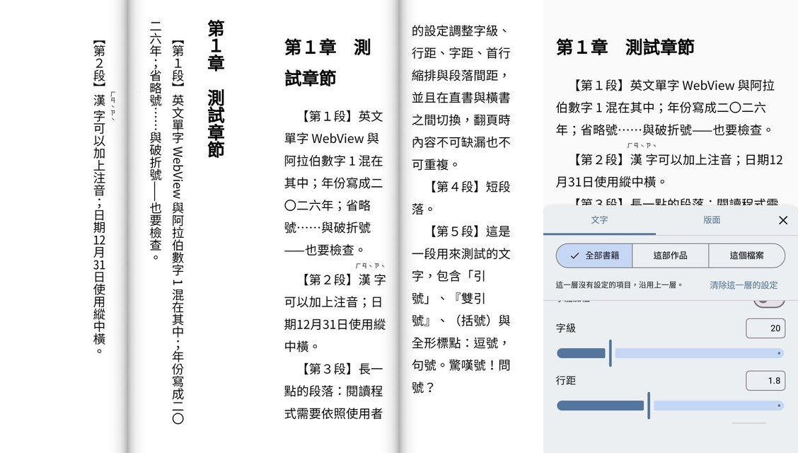

<div align="center">


# Bookmania

Android 上的電子書閱讀器，為中文的直排與橫排排版而做。

[English](./README.en.md) ・ [下載](https://github.com/N09527/bookmania/releases) ・ [變更紀錄](./CHANGELOG.md) ・ [回報問題](https://github.com/N09527/bookmania/issues)

[](./LICENSE)
[](#下載)



</div>

## 功能

### 文字書閱讀器

- 支援 EPUB（2、3）、MOBI 與 AZW3（KF8）。把書放進本機來源的資料夾，就能從「探索 > 本機來源」開啟，並加入書櫃。
- 直排與橫排；翻頁方向可以依書籍設定，或固定右開、左開。
- 單欄或雙欄，也可以只在橫向畫面使用雙欄。雙欄時，兩欄中間可以加上中縫陰影。
- 排版：字體（可以匯入 TTF／OTF 字型）、字級、行距、字距、首行縮排、段落間距、上下左右邊距、字體加粗。每個數值都可以拖動滑桿，或直接輸入。
- 設定分三層：全部書籍、這部作品、這個檔案。
- 注音（ruby）照書中的標記顯示。
- 翻頁動畫：捲曲、滑動或不使用動畫。
- 目錄、全書進度滑桿、同一部作品的章節面板；點擊區域與音量鍵翻頁。
- 記住每本書的閱讀位置，並更新書櫃裡的進度、已讀狀態與閱讀紀錄。備份會包含閱讀位置。

### 安全與隱私

- 只能閱讀沒有 DRM 的書。受 DRM 保護的書會顯示說明，不會嘗試解密。Bookmania 不提供、也不會加入移除 DRM 的功能。
- 書籍內容一律視為不可信：書裡的腳本不會執行，書的內容不能連上網路，也不能讀取 App 的其他檔案。
- 不傳送當機報告，也不收集使用分析資料。

### 沿用自 Yōkai 的功能

書櫃與分類、本機來源、漫畫（圖片）閱讀器、備份與還原等，都沿用自 Yōkai。漫畫閱讀器的捲曲翻頁與雙頁中縫陰影是 Bookmania 加上的。

Yōkai 原有的線上來源擴充與追蹤服務仍在 App 中，但 Bookmania 沒有針對它們做測試。

## 下載

- 到 [Releases](https://github.com/N09527/bookmania/releases) 下載 APK。一般手機選 `arm64-v8a`；如果裝不了，再選 `universal`。
- 需要 Android 8.0 以上。
- 每個版本都附上 APK 的 SHA-256，可以用來核對檔案。

## 從原始碼建置

需要 JDK 21 與 Android SDK。

```bash
./gradlew :app:assembleBookmaniaDebug
```

APK 會出現在 `app/build/outputs/apk/bookmania/debug/`。簽章版 release 的建置與發布方式見 [docs/RELEASING.md](./docs/RELEASING.md)。

## 由來

Bookmania 是從 [Yōkai](https://github.com/null2264/yokai) 分出來的（Yōkai 的 commit `843a59b`，當時的版本號是 1.10.3）。之後加上了全新的電子書閱讀器，改寫了很多部分，現在是一個獨立的 App，不再跟隨 Yōkai 的更新。Yōkai 本身源自 TachiyomiJ2K 與 Tachiyomi。

感謝 Yōkai、TachiyomiJ2K、Tachiyomi 的作者與所有貢獻者。MOBI／AZW3 的讀取程式移植自 [foliate-js](https://github.com/johnfactotum/foliate-js)（MIT 授權）。App 使用的所有開源元件與授權，列在「設定 > 關於 > 開放原始碼授權」。

Bookmania 與 Yōkai、Tachiyomi、Mihon 沒有隸屬關係。這些名稱屬於各自的所有者，這裡只用來說明來源。

## 開發紀錄

各階段的設計、測試與報告（正體中文）在 [docs/ebook-reader](./docs/ebook-reader)。

## 參與

- 回報問題或提出建議：請到 [Issues](https://github.com/N09527/bookmania/issues)。
- 貢獻程式碼：請先看 [CONTRIBUTING](./.github/CONTRIBUTING.md)。

## 免責聲明

本 App 不提供任何書籍或其他內容，開發者與任何內容提供者都沒有關係。請只閱讀你有權使用的書。

## 授權

<pre>
Copyright © 2015 Javier Tomás
Copyright © 2024 null2264
Copyright © 2026 N09527

Licensed under the Apache License, Version 2.0 (the "License");
you may not use this file except in compliance with the License.
You may obtain a copy of the License at

http://www.apache.org/licenses/LICENSE-2.0

Unless required by applicable law or agreed to in writing, software
distributed under the License is distributed on an "AS IS" BASIS,
WITHOUT WARRANTIES OR CONDITIONS OF ANY KIND, either express or implied.
See the License for the specific language governing permissions and
limitations under the License.
</pre>

修改與新增的部分見 [NOTICE](./NOTICE)。
